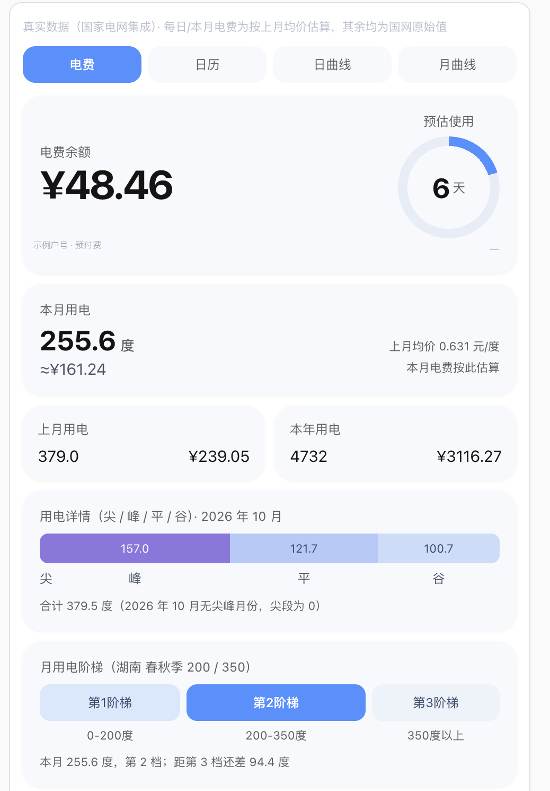
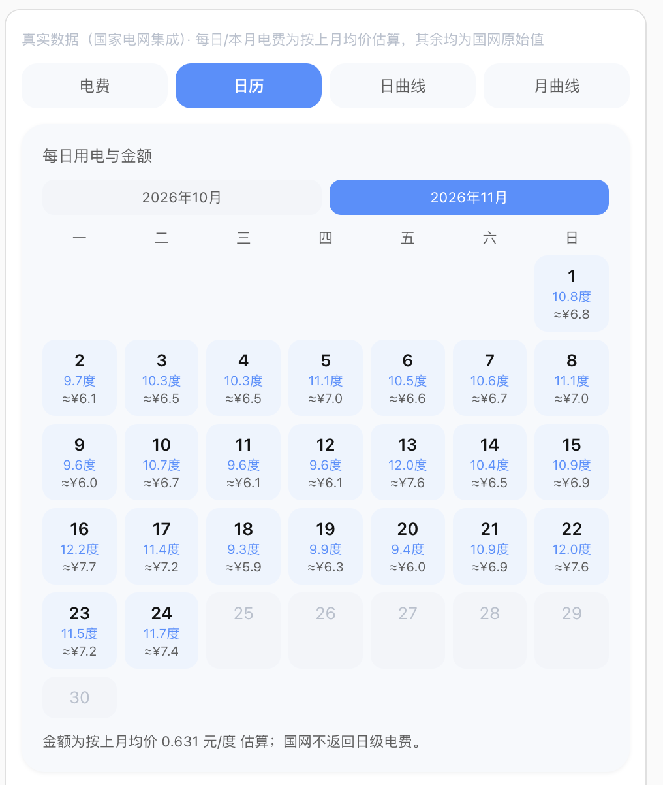
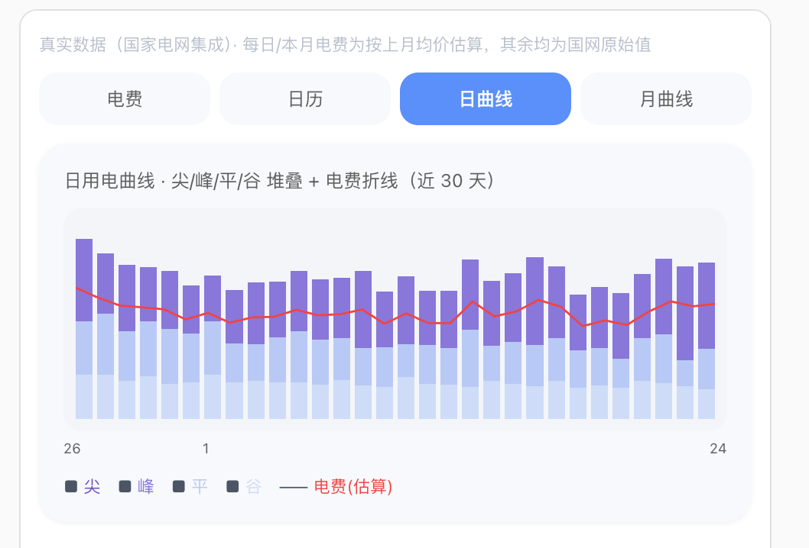
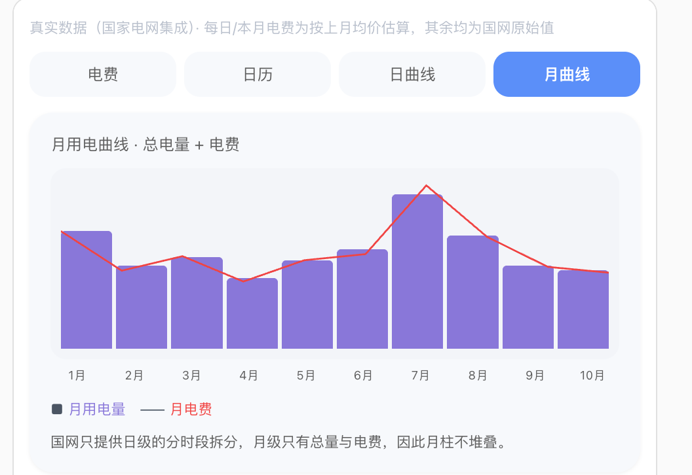

# 国网电费卡片（Home Assistant）

把「网上国网」的电费余额、用电量、峰谷平尖、电费日历与日月曲线，做成一张手机端的卡片，嵌进 Home Assistant。

> 数据来自 HACS 自定义集成 [`state_grid`](https://github.com/stevenjoezhang/hass-state-grid)（国家电网）。
> 本项目只做**展示层**：一个独立的单文件 HTML，用 `iframe` 卡嵌入，不新增容器、不额外保存账号口令。


| 日历 | 日曲线 | 月曲线 |
|---|---|---|
|  |  |  |

> 截图为真实部署效果，户名/户号已脱敏为「示例户号」，数值为真实用电数据。

---

## 效果

四个页签：

| 页签 | 内容 |
|---|---|
| 电费 | 余额 + 预估可用天数（环形）、本月用电、上月/本年、尖/峰/平/谷四段条、月用电阶梯（按季节自动切档位阈值） |
| 日历 | 按月网格，每格显示当日度数（金额为估算） |
| 日曲线 | 近 30 天尖/峰/平/谷堆叠柱 + 电费折线 |
| 月曲线 | 近 12 个月电量柱 + 电费折线 |

深浅主题自动跟随宿主（读取 HA 的 `hass.themes.darkMode`）。

## 前置条件

1. HA 里已安装并成功运行 `state_grid` 集成（HACS 自定义仓库 `stevenjoezhang/hass-state-grid`），且已有可用户号。
2. 该户号**已开通峰谷分时**，否则尖/峰/平/谷只有 0。

## 安装（三步）

### 1. 放文件

把 `index.html` 传到 NAS/主机上的 HA 配置目录：

```
/config/www/dianfei/index.html
```

（`/config/www` 即 HA 的 `/local`，文件最终通过 `/local/dianfei/index.html` 访问。）

### 2. 填配置

用文本编辑器打开 `index.html`，找到 `var CONFIG={...}`，把 7 个实体 ID 换成你自己的。

去哪里找：HA → 开发者工具 → 状态 → 搜索你的**户号末四位**，会看到一组 `sensor.<hash>_*` 实体，名字对应：
`account_balance` / `current_month_usage` / `previous_settled_month_usage` / `previous_settled_month_charge` / `current_year_usage` / `current_year_charge` / `previous_daily_usage`。

`account` 字段是卡片上显示的名字，随意填。

### 3. 建仪表盘

设置 → 仪表盘 → 添加仪表盘，URL 比如 `dianfei`，模式选「存储模式」。
新建视图，添加卡片 → 手动（YAML）：

```yaml
type: iframe
url: /local/dianfei/index.html?v=1
aspect_ratio: 240%
```

保存后访问 `http://<你的HA>:8123/dianfei`。

## ⚠️ 改完文件必须改版本号

HA 对 `/local/` 下的静态文件设了 **31 天强缓存**（`Cache-Control: max-age=2678400`）。
每次修改 `index.html`，都要把 iframe 的 URL 从 `?v=1` 改成 `?v=2`、`?v=3`……
**否则浏览器一直读旧缓存**，表现为"改了没生效"，甚至打开是白屏。

## 数据口径说明

- **真实数据**：余额、本月/上月/本年电量与电费、尖峰平谷四段、日明细、月明细。
- **估算数据**：每日金额、本月电费 —— 国网接口**不返回日级电费**，页面按「上一结算月均价」折算，界面上带 `≈`。
- **月柱不堆叠**：国网只提供**日级**的分时段拆分，月级只有总量与电费。
- **尖峰只在 1/7/8/12 月存在**，其它月份尖段为 0，属正常。
- 逐日求和与账单电量可能有 0.5 度级差异，是国网侧四舍五入。

## 阶梯档位

按湖南省现行居民阶梯电价：春秋季（3/4/5/9/10/11 月）为 200 / 350 度分档，冬夏季（1/2/6/7/8/12 月）为 200 / 450 度。
**其它省份请改 `renderMain()` 里的 `spring` 月份数组与 `t2` 阈值**。

## 兼容性

- 需要浏览器支持 `conic-gradient`、`backdrop-filter`（可选）、CSS 变量 —— iOS Safari 15+ / Chrome 90+ 均可。
- 通过同源 iframe 读取 `window.parent` 的 `hass.states`，**不需要额外令牌**；若直接从浏览器打开该 html 文件（非 HA 内），会显示"未读到 HA 数据"。

## 免责

非官方项目，与国网、Home Assistant 官方无关。数据由第三方集成抓取，接口变动可能导致失效，请自行评估账号风险。

## License

MIT